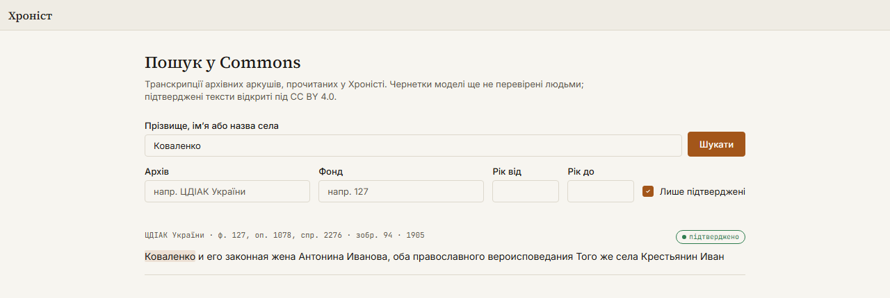
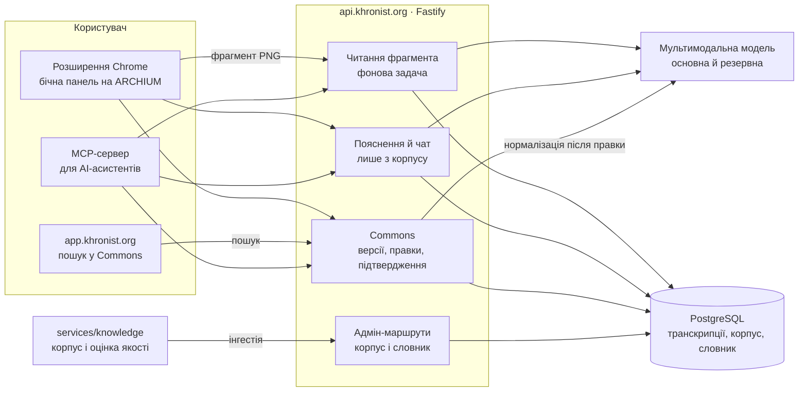

<div align="center">


# Хроніст

**AI-компаньйон для дослідників українських архівів**

Читає рукописні скани прямо на архівному порталі, пояснює терміни й дати з джерелами,<br>а підтверджені людьми транскрипції відкриває для всіх під CC BY 4.0.

[](https://github.com/code-by-accident/Khronist-real-platform/actions/workflows/ci.yml)
[](LICENSE)
[](https://creativecommons.org/licenses/by/4.0/deed.uk)


[Сайт](https://khronist.org) · [Пошук у Commons](https://app.khronist.org) · [Посібник користувача](docs/user-guide.md) · [API](https://api.khronist.org/health) · [Як долучитися](CONTRIBUTING.md)

</div>

---

Мільйони аркушів українських архівів уже оцифровано, але читати їх важко: рукопис, дореформена орфографія, скорочення, юліанські дати. Хроніст робить такий скан джерелом, з яким можна працювати: **читає, пояснює, цитує** і робить прочитане доступним для всіх.

Проєкт створено для Культурного хакатону OBRIO × МУР, трек «Історія».

<p align="center">
  
</p>

## Що вміє

| | Можливість | Де |
| --- | --- | --- |
| 📜 | **Читання рукопису.** Виділіть запис на скані, і за кілька секунд він стане текстом: рядок у рядок, непевні слова позначено, а попередження про обрізаний текст, пошкоджений папір чи бліде чорнило показано окремо | розширення |
| 🇺🇦 | **Переклад українською.** Під рядками російськомовного запису — машинний переклад з тією самою нумерацією рядків | розширення |
| 🔎 | **Сутності й пояснення.** Імена, місця, дати й терміни стають чипами; клік пояснює їх лише за довідковим корпусом, з джерелом і ліцензією, а дату переводить зі старого стилю в новий | розширення |
| 💬 | **Чат «Спитати».** Запитання про терміни, дати, місця чи прочитаний фрагмент. Без джерела Хроніст чесно каже, що відповіді немає, а не вигадує | розширення |
| ✍️ | **Правка й підтвердження.** Виправте рядок (з панеллю старих літер ѣ, і, ъ, ѳ, ѵ…), а перевірені люди підтверджують текст, і він стає частиною Commons | розширення |
| 📎 | **Цитата.** ДСТУ 8302:2015, Markdown або простий текст, з транскрипцією чи без | розширення |
| 🌐 | **Пошук у Commons.** Пошук за прізвищем, іменем чи назвою села серед прочитаних аркушів (типово — лише підтверджених), з урахуванням давніх написань | [app.khronist.org](https://app.khronist.org) |
| 🤖 | **MCP-сервер.** Ті самі читання, пояснення й пошук в AI-асистенті з підтримкою MCP (наприклад, Claude Desktop) | [apps/mcp](apps/mcp/README.md) |

Як цим користуватися, крок за кроком: **[посібник користувача](docs/user-guide.md)**.

## Стан проєкту

| Частина | Стан |
| --- | --- |
| API | працює: `https://api.khronist.org` |
| Пошук у Commons | працює: `https://app.khronist.org` |
| Розширення Chrome | працює на ARCHIUM ЦДІАК України (`archium.cdiak.archives.gov.ua`); у Chrome Web Store ще немає, встановлюється вручну |
| MCP-сервер | запускається локально з клону репозиторію (stdio) |
| Інші портали, нотатник, вебробоче місце з завантаженням сканів | ще немає |

## Як це працює



1. Панель вирізає виділений фрагмент скану й надсилає його в API. Сам скан не зберігається: сервер тримає хеш фрагмента, шифр аркуша й прочитаний текст.
2. Модель читає фрагмент, і рядки з'являються в панелі. Далі текст зводиться до сучасної орфографії, з нього беруться сутності, а російськомовний запис перекладається українською.
3. Те саме виділення пізніше приходить із кешу, а вже прочитане на аркуші видно одразу.
4. Чернетку моделі вже можна знайти й процитувати з позначкою «чернетка». Правка створює нову версію, а після підтвердження людиною текст публікується під CC BY 4.0 з підписом.

## Для розробників

### Що потрібно встановити

| Інструмент       | Версія                                  | Для чого                  |
| ---------------- | --------------------------------------- | ------------------------- |
| Node.js          | 24 або новіша                           | увесь TypeScript-код      |
| pnpm             | 12.16.1 (`npm install -g pnpm@12.16.1`) | залежності й команди      |
| Docker Desktop   | будь-яка актуальна                      | локальний PostgreSQL 18   |
| uv і Python 3.12 | актуальний uv                           | для `services/knowledge`  |
| GitHub CLI       | необов'язково                           | PR із термінала           |

У Windows uv і GitHub CLI ставляться так: `winget install astral-sh.uv` і `winget install GitHub.cli`. Після цього треба перезапустити термінал і редактор, інакше команд не буде в `PATH`.

### Перший запуск

Docker Desktop має бути запущений. Команди виконуються в корені репозиторію.

```sh
pnpm install
cp .env.example .env
docker compose -f infra/docker-compose.yml up -d
pnpm db:migrate
pnpm dev
```

У PowerShell замість `cp` працює `Copy-Item .env.example .env`.

Перевірка: `GET http://localhost:3000/health` повертає `{"ok":true,"db":"ok","llm":"degraded","htr":"fixture"}`.

- `htr: "fixture"`: читання фікстурне, бо в `.env.example` стоїть `LLM_FIXTURES=1`. Будь-яке зображення дає той самий демонстраційний текст, а гроші не витрачаються.
- `llm: "degraded"`: немає ключа API. Для роботи з фікстурами це нормально.

`pnpm dev` запускає також розширення (WXT відкриває окремий Chrome) і вебзастосунок (`http://localhost:5173`); обидва ходять у цей локальний API, а не в прод. Для справжнього читання задайте `ANTHROPIC_API_KEY` і приберіть `LLM_FIXTURES=1`. Спершу зітріть локальну базу (`docker compose -f infra/docker-compose.yml down -v`, потім знову `up -d` і `pnpm db:migrate`), бо кеш віддає фікстурні транскрипції як справжні.

### Команди

| Команда             | Що робить                             |
| ------------------- | ------------------------------------- |
| `pnpm dev`          | запускає застосунки в режимі розробки |
| `pnpm lint`         | перевіряє код через oxlint            |
| `pnpm typecheck`    | перевіряє типи                        |
| `pnpm test`         | запускає тести, Docker не потрібен    |
| `pnpm build`        | збирає пакети                         |
| `pnpm format`       | форматує код через Prettier           |
| `pnpm format:check` | перевіряє форматування                |
| `pnpm db:generate`  | створює міграцію зі змін у схемі      |
| `pnpm db:migrate`   | застосовує міграції                   |

### Структура

| Тека                 | Що там                                                                              | Власник                |
| -------------------- | ----------------------------------------------------------------------------------- | ---------------------- |
| `apps/api`           | API на Fastify 5 і Drizzle ([README](apps/api/README.md))                           | Владислав              |
| `apps/extension`     | розширення Chrome на WXT ([README](apps/extension/README.md))                       | Владислав              |
| `apps/web`           | вебзастосунок: пошук у Commons ([README](apps/web/README.md))                       | Владислав              |
| `apps/mcp`           | MCP-сервер ([README](apps/mcp/README.md))                                           | Владислав              |
| `packages/ui`        | тема daisyUI і компоненти з Figma ([README](packages/ui/README.md))                 | Владислав              |
| `packages/contracts` | Zod-схеми й типи                                                                    | Владислав і ML-команда |
| `packages/prompts`   | промпти                                                                             | ML-команда             |
| `packages/config`    | спільні налаштування                                                                | Владислав              |
| `services/knowledge` | корпус, словник варіантів, оцінка читання ([README](services/knowledge/README.md)) | Анна і Катерина        |
| `infra`              | локальний PostgreSQL                                                                | Владислав              |
| `.railway`           | сервіс API і база на Railway                                                        | Владислав              |
| `docs`               | план, контекст, рішення, посібник користувача                                       | уся команда            |

## Документація

| Документ | Для кого |
| --- | --- |
| [Посібник користувача](docs/user-guide.md) | дослідники: встановлення, читання, правка, цитата, пошук |
| [CONTRIBUTING.md](CONTRIBUTING.md) | розробники: гілки, коміти, перевірки, типові проблеми |
| [Контекст проєкту](docs/project-context.md) | усі, хто підхоплює роботу з нуля |
| [План](docs/plan/README.md) і [контракти](docs/plan/07-contracts.md) | розробники: етапи й API |
| [Журнал рішень](docs/decisions.md) | усі: що й чому вирішено |

## Ліцензія

Код — [Apache-2.0](LICENSE). Підтверджені транскрипції Commons публікуються під [CC BY 4.0](https://creativecommons.org/licenses/by/4.0/deed.uk). Скани належать архівам і в репозиторії не зберігаються.
