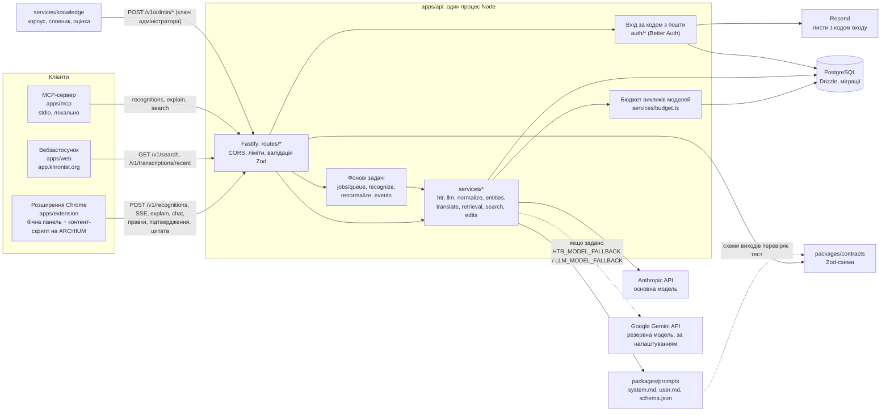
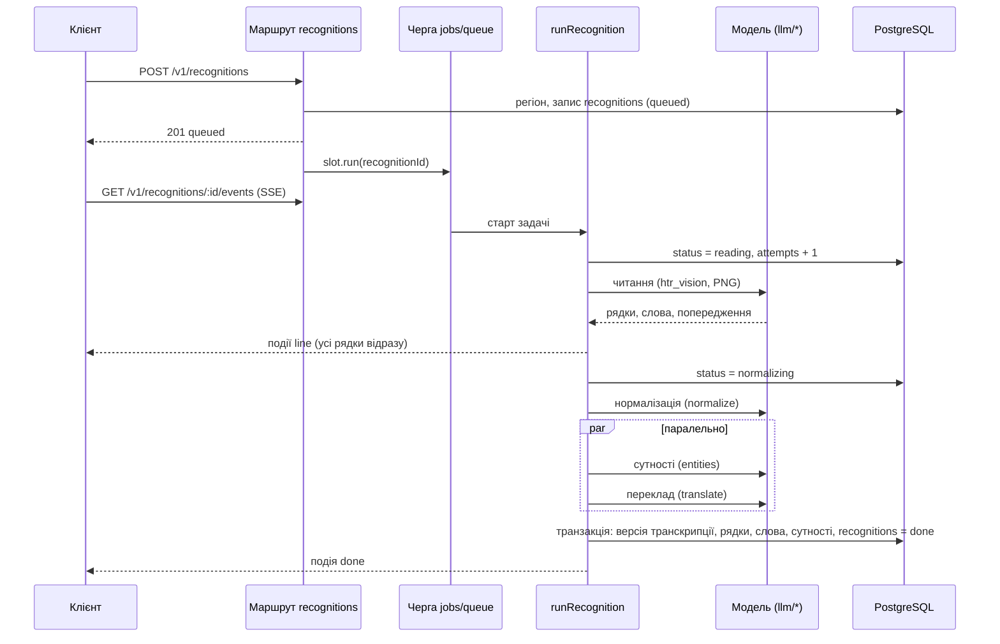

# Архітектура Хроніста

Документ описує, як система влаштована за поточним кодом репозиторію. Усі твердження звірено з кодом; там, де код не дає відповіді, стоїть позначка `TODO(перевірити)`. Змінні середовища, ліміти й налаштування моделей зібрано в [configuration.md](configuration.md).

## 1. Призначення

Хроніст допомагає дослідникам українських архівів працювати зі сканами рукописів:

- читає виділений на скані фрагмент рукопису мультимодальною моделлю (рядки, непевні слова, попередження про якість скану);
- зводить прочитане до сучасної орфографії, виділяє сутності (особи, місця, дати, терміни) і перекладає російськомовний запис українською;
- пояснює терміни, місця й дати, а також відповідає на запитання лише за довідковим корпусом, з цитатами й ліцензією джерела; без джерела відповідає «не знаю»;
- зберігає версії транскрипції, дозволяє правити рядки; підтвердження людиною з правом підтверджувати переводить версію в статус `verified`;
- відкриває прочитане й підтверджене через пошук у Commons (веб, API, MCP) і формує цитату (ДСТУ, Markdown, простий текст).

Сам скан сервер не зберігає: у базі лежать хеш фрагмента (SHA-256 від байтів PNG), шифр аркуша й прочитаний текст (`apps/api/src/db/schema.ts`, таблиці `regions`, `pages`, `transcriptions`).

Підтримуваний портал у коді один: переглядач ARCHIUM `archium.cdiak.archives.gov.ua` (`archiumHosts` у `packages/contracts/src/common.ts`, `apps/extension/portal/archium.ts`). Розширення працює лише на ньому.

## 2. Склад репозиторію

| Тека                 | Роль                                                                                                      |
| -------------------- | --------------------------------------------------------------------------------------------------------- |
| `apps/api`           | HTTP API (Fastify 5, Drizzle ORM, PostgreSQL), фонові задачі в тому самому процесі                        |
| `apps/extension`     | розширення Chrome (Manifest V3, WXT, React 19): бічна панель і накладка виділення на сторінці порталу     |
| `apps/web`           | вебзастосунок (Vite, React 19): пошук у Commons і стрічка «Нещодавно підтверджені»                        |
| `apps/mcp`           | MCP-сервер (stdio) з трьома інструментами, тонкий клієнт публічного API                                   |
| `packages/contracts` | Zod-схеми й типи запитів, відповідей і виходів моделей; спільні для API, розширення, вебу, MCP і промптів |
| `packages/prompts`   | тексти промптів і завантажувач; схеми виходів у `schema.json` кожного промпту                             |
| `packages/ui`        | дизайн-система: тема daisyUI, компоненти, українські рядки інтерфейсу (`src/strings.uk.ts`)               |
| `packages/config`    | спільна база `tsconfig`                                                                                   |
| `services/knowledge` | Python 3.12: довідковий корпус, словник варіантів, інгестія в API, оцінка читання й відповідей            |
| `infra`              | `docker-compose.yml` з локальним PostgreSQL 18                                                            |
| `.railway`           | опис інфраструктури Railway (`railway.ts`)                                                                |

Монорепозиторій керується pnpm workspace (`pnpm-workspace.yaml`: `apps/*`, `packages/*`) і Turborepo (`turbo.json`). Пакети `@khronist/contracts` і `@khronist/prompts` віддають сирий `.ts` (`exports` вказує на `src/index.ts`); Node 24 виконує такі файли напряму, тому API запускається без етапу збірки.

## 3. Схема компонентів

Особливості, які видно зі схеми:

- Усе, що потребує моделі, проходить через `apps/api/src/services/llm` і лічильник бюджету; клієнти самі моделей не викликають.
- Стан задач (черга, канали подій, лічильники ліміту) живе в пам'яті процесу API; розрахунок іде на один екземпляр сервісу (див. розділ 14).
- `services/knowledge` не пише в базу напряму: корпус і словник потрапляють у БД лише через `/v1/admin/*`.
- Окремого сервісу HTR немає: змінна `HTR_URL` зарезервована, а будь-яке непорожнє значення зупиняє запуск (`apps/api/src/config.ts`).

## 4. Контракти й промпти

### 4.1. `packages/contracts`

Пакет містить Zod-схеми, з яких виводяться типи (`z.infer`), без залежності від Fastify чи Drizzle. Файли в `packages/contracts/src`:

| Файл                       | Що описує                                                                                                    |
| -------------------------- | ------------------------------------------------------------------------------------------------------------ |
| `common.ts`                | шифр (`shelfmarkSchema`), рамка, слово, рядок, сутність, цитата, підказки (`hints`), помилка                 |
| `recognitions.ts`          | запит і відповідь `POST /v1/recognitions`, стан, події SSE, правка рядків, підтвердження, історія, конфлікт  |
| `search.ts`                | пошук, стрічка нещодавно підтверджених, пошук аркуша, цитата                                                 |
| `explain.ts`               | «Пояснити» й чат: запити, відповіді, виходи моделей, `isGroundedQuote`                                       |
| `htr.ts`, `vision-lines.ts`| вихід моделі читання й перетворення на рядки (`visionToLines`)                                               |
| `normalize.ts`, `entities.ts`, `translate.ts` | виходи моделей нормалізації, сутностей і перекладу                                       |
| `admin.ts`                 | завантаження джерел, чанків і словника, статистика                                                           |
| `auth.ts`, `health.ts`     | вхід, сесія, стан сервісу                                                                                    |

API використовує ті самі схеми для валідації тіла й запиту (`fastify-type-provider-zod`) і для серіалізації відповідей (`schema.response` у кожному маршруті); розширення, веб і MCP розбирають відповіді тими самими схемами. Контракт у коді є єдиним описом форми даних: клієнти й сервер підлаштовуються під нього.

Є схеми без реалізації: `htrRequestSchema`/`htrResponseSchema` (віддалений читач; у коді ніде не використовуються), поле `place` у `explainResponseSchema` (сервіс його не заповнює).

### 4.2. `packages/prompts`

Кожен промпт — тека з `system.md`, `user.md`, `schema.json`, `README.md` (і `examples.jsonl`, окрім `htr_vision`). Доступні імена (`PromptName` у `packages/prompts/src/index.ts`): `htr_vision`, `normalize`, `translate`, `entities`, `explain`, `chat`.

- `loadPrompt(name)` читає файли з диска під час виклику (`readFileSync`) і повертає `{ system, user, schema }`. `system` складається зі спільної персони `_shared/persona.md` і `<name>/system.md`.
- `renderPrompt(template, values)` підставляє змінні `{{name}}`; відсутнє значення — помилка. Користувацькі дані (текст запису, запитання, історія діалогу, статті корпусу) передаються лише як JSON-рядки, щоб текст не міг видати себе за інструкцію.
- `loadProviderNotes(name, 'gemini')` читає додаток `<name>/gemini.md`. Додатки існують для `htr_vision`, `explain`, `chat`, і API підключає їх лише для резервної моделі Gemini (`geminiNotes` у `selectProvider`). Для `normalize`, `entities`, `translate` додатків немає.
- `schema.json` кожного промпту дорівнює JSON-схемі відповідної Zod-схеми з contracts; це перевіряє `packages/prompts/test/prompts.test.ts`. Під час виклику API передає моделі схему, перетворену з Zod (`toJsonSchema` у `services/llm/index.ts`), а не `schema.json` напряму.

Підключення в API:

| Промпт       | Хто використовує                         | Файл                                       |
| ------------ | ---------------------------------------- | ------------------------------------------ |
| `htr_vision` | читання фрагмента                        | `apps/api/src/services/htr/vision.ts`      |
| `normalize`  | нормалізація орфографії                  | `apps/api/src/services/normalize.ts`       |
| `entities`   | виділення сутностей                      | `apps/api/src/services/entities.ts`        |
| `translate`  | переклад українською                     | `apps/api/src/services/translate.ts`       |
| `explain`    | «Пояснити»                               | `apps/api/src/services/explain.ts`         |
| `chat`       | чат                                      | `apps/api/src/services/chat.ts`            |

## 5. Потік «читання фрагмента»

### 5.1. Що відбувається в розширенні

1. Контент-скрипт (`apps/extension/entrypoints/archium.content.tsx`) працює лише на `https://archium.cdiak.archives.gov.ua/*`. Він знаходить зображення скану `img#main-image` і читає шифр із сторінки (`portal/archium.ts`: архів, фонд, опис, справа з розділу `.description-item`, номер зображення з мініатюри, адреса переглядача).
2. Користувач запускає виділення з панелі чи гарячою клавішею `Alt+Shift+X` (`entrypoints/background.ts` відкриває бічну панель). Накладка `SelectionOverlay` з `@khronist/ui` вмонтовується в shadow root на сторінці.
3. `scan/fragment.ts` перетинає виділення з видимою областю скану (`scanRegion`), переводить координати у пікселі оригінального зображення, вирізає фрагмент на `OffscreenCanvas` і кодує в PNG. Розмір обмежується стороною 2576 px і 3,75 мегапікселя (`maxModelSide`, `maxModelPixels`); якщо PNG більший за 7 МіБ, розмір зменшується кроком 0,8. Рамка `box` зберігається у частках розмірів оригіналу. Хеш `imageHash` — SHA-256 від байтів PNG (`crypto.subtle`).
4. Контент-скрипт надсилає в панель повідомлення `fragment` (або `fragment-failed` з причиною `outside`, `not_loaded`, `crop`) через `browser.runtime.sendMessage`; схеми повідомлень — `apps/extension/messages.ts`.
5. Панель (`entrypoints/sidepanel/useReading.ts`, `api/client.ts`) надсилає `POST /v1/recognitions` із полями `shelfmark`, `image.base64Png`, `box`, `imageHash`, `source: "extension"`. Підказки (`hints`) і роки справи (`document`) розширення не передає.

### 5.2. Прийом запиту в API

Маршрут `apps/api/src/routes/recognitions.ts`, логіка `createRecognition` у `apps/api/src/services/recognitions.ts`:

1. Хуки `onRequest`: `identifyApiKey` (якщо `Authorization: Bearer khr_…`, хеш SHA-256 ключа шукається в `api_keys`; невідомий ключ — `401`, перевірки невідомих ключів обмежені 10 на хвилину) і ліміт 10 запитів на хвилину на клієнта.
2. Валідація тіла за `createRecognitionRequestSchema`, `bodyLimit` 12 МіБ.
3. `decodePng` (`lib/image.ts`): підпис PNG, `IHDR`, `IEND`, не більше 7 МіБ, сторона не більше 8000 px, не більше 50 мегапікселів. Сервер сам рахує SHA-256 і порівнює з `imageHash`; розбіжність — `400 bad_image`.
4. Кеш: `regions.image_hash` має унікальний індекс. Якщо для хеша вже є регіон і в ньому є хоч одна транскрипція, відповідь одразу `201 { status: "cached", transcriptionId }`; створюється запис `recognitions` зі статусом `done`. Модель не викликається, ні денний ліміт, ні бюджет не витрачаються. Кеш точний: збіг лише за байтами PNG.
5. Якщо кешу немає: за відсутності читача (`reader`) або вичерпаного бюджету (`budget.available()`) — `503 reader_unavailable`.
6. Якщо регіон відомий, застарілі активні розпізнавання (старші за 10 хвилин) закриваються як `read_failed`; якщо активне розпізнавання на цей хеш уже є, повертається його `recognitionId` зі статусом `queued` (повторний клік чи другий клієнт не створює другої задачі). Те саме на рівні БД гарантує частковий унікальний індекс `recognitions_one_active_per_region`.
7. Слот у черзі: `queue.reserve(clientKey, { total: 50, perOwner: 3 })`. Відмови: `503 shutting_down`, `429` («черга повна» або «забагато одночасних розпізнавань»).
8. Денний ліміт нових читань: гість — `GUEST_RECOGNITIONS_PER_DAY` на адресу клієнта, ключ API — `API_KEY_RECOGNITIONS_PER_DAY` на ключ. Витрачається лише коли справді починається нове читання.
9. Знаходиться або створюється сторінка (`findOrCreatePage`: `documents` за шифром без номера аркуша, потім `pages`), регіон (`findOrCreateRegion`) і рядок `recognitions`. Гонка двох запитів на той самий регіон розв'язується порушенням унікального індексу: програвший отримує `recognitionId` переможця.
10. Задача ставиться в чергу (`slot.run`), відповідь `201 { recognitionId, status: "queued" }`.

Метадані сторінки (посилання на портал `portalUrl`, номер аркуша `folio`, роки справи `document`) записуються лише для клієнтів із ключем API (`trusted`). Гостьові запити створюють документ і сторінку за шифром, але без посилання й років; посилання на порталі потім може додати той, хто підтверджує (розділ 6).

### 5.3. Фонова задача

Черга: `apps/api/src/jobs/queue.ts` (`p-queue`, паралельність `JOBS_CONCURRENCY`). Задача `runRecognition` у `apps/api/src/jobs/recognize.ts`:

Стадії й статуси (`recognition_status`): `queued` → `reading` → `normalizing` → `done` або `failed`.

1. **Читання.** `setStatus('reading')` ставить `started_at` і збільшує `attempts` (лише тут; автоматичного перезапуску задачі немає). Читач вибирається в `apps/api/src/services/htr/index.ts`: з `LLM_FIXTURES` — демонстраційний `fixture`, інакше `createVisionReader` над провайдером моделі. Модель отримує PNG і текст `user.md` з підказками (`language`, `period`, `documentType`; без підказок — `unknown`); вона повертає рядки зі словами, позначкою непевності й список попереджень. Вихід валідується: слова рядка мають давати текст рядка, без NUL і самотніх сурогатів; літера «Ө/ө» замінюється на «Ѳ/ѳ» (`restoreFita`); невідомі попередження відкидаються. Модель не повертає координат, тому `visionToLines` ділить фрагмент на рівні горизонтальні смуги за кількістю рядків із `boxSource: 'estimated'`. Загальний ліміт читання 75 с (`readTimeoutMs`). Порожній результат — помилка `no_text`. Після успішного читання всі рядки публікуються в канал подій відразу (`line`), а не по одному під час читання.
2. **Нормалізація.** Статус `normalizing`. Нормалізатор зводить текст до сучасної орфографії, зберігаючи кількість рядків і слів, і повертає список розкриттів скорочень (`expansions`). Результат проходить `assertNormalized` (`services/normalize.ts`): однакова кількість рядків і слів; слово може відрізнятися лише орфографією (правила `spellingKey`: ѣ, ѳ, і/ѵ, ъ, закінчення на кшталт «-аго») або бути оголошеним розкриттям; непевність слова не можна втрачати. Нормалізація, сутності й переклад виконуються лише для підказки `language` = `ru` або без підказки (`isRussianOrUnmarked`).
3. **Сутності й переклад** (паралельно, `jobs/enrichment.ts`). Сутності виділяються з нормалізованого тексту (`placeEntities` шукає знайдені моделлю фрагменти в тексті й обчислює позиції; те, чого немає в тексті, відкидається; для дат додається `extra.newStyle` і день тижня через `services/calendar.ts`, юліанський календар у межах 5.10.1582–31.01.1918). Переклад виконується лише за наявності нормалізації; він мусить зберігати кількість рядків, позначки `[нрзб]` і не містити латиниці, якої немає в оригіналі (`translationProblem`).
4. **Часткова відмова не є відмовою.** Якщо нормалізація, сутності чи переклад не вдалися (помилка, тайм-аут, невалідний вихід), задача логує попередження й зберігає транскрипцію без цього шару (рядки «як прочитано», без сутностей, без перекладу). Відмовою завершується лише читання, збереження або закриття сервером.
5. **Збереження** (`saveTranscription`): одна транзакція створює нову версію транскрипції (`insertTranscriptionVersion` у `services/transcriptions.ts`: `transcriptions`, `transcription_lines`, `line_words`, `entities`) і ставить `recognitions.status = 'done'` та `transcription_id`. Якщо запис за цей час закрито іншим шляхом, задача завершується без збереження.
6. **Помилки.** Коди `read_failed`, `no_text`, `normalize_failed`, `save_failed`, `restarted`, `bad_image`, `too_large` (`recognitionFailureCodeSchema`) зберігаються в `recognitions.error_code`, повідомлення українською — `failureMessages`.

### 5.4. Основна й резервна модель, повторні спроби

Код у `apps/api/src/services/llm/`:

- `select.ts` (`selectProvider`) збирає провайдера: основна модель (Anthropic, якщо ім'я починається з `claude-`; Google, якщо з `gemini-`), необов'язкова резервна. Кожен провайдер обгорнуто лічильником бюджету (`withCallBudget`). Якщо ключа основної моделі немає, а резервної є, резервна стає основною. Резервна модель із відсутнім ключем зупиняє запуск (`config.ts`).
- `withFallback` (`llm/index.ts`): якщо резерв заданий, основна модель (разом із повтором після невалідного виходу) має обмежений час: 15 с для читання, 20 с для нормалізації, 8 с для сутностей, 15 с для перекладу, «Пояснити» й чату (`lib/limits.ts`). Без резерву такого обмеження немає, діє лише загальний тайм-аут задачі. Якщо вона збоїть або не вклалася в ліміт, запит іде на резервну. Відмова за лімітом чи білінгом провайдера (HTTP 402 і 429, `LlmLimitError`) на резерв не перемикає.
- `retryInvalidOutput`: якщо відповідь не є валідним JSON або не відповідає схемі (`LlmOutputError`), запит повторюється один раз тією самою моделлю.
- Anthropic (`anthropic.ts`): SDK з `maxRetries: 0`, структурований вихід `json_schema`, глибина роздумів `effort`, бета-заголовок `server-side-fallback-2026-07-01` із `fallbacks: 'default'` (серверний запасний варіант самого Anthropic на випадок відмови моделі; його семантику визначає API провайдера). У `transcriptions.reader` записується модель, яка справді відповіла.
- Gemini (`gemini.ts`): інтерфейс `interactions`, `store: false`, JSON-вихід за схемою, `thinking_level: 'low'` завжди, повтори SDK вимкнено. Основний промпт доповнюється `gemini.md`, якщо він є.

### 5.5. Доставка результату клієнту

- `GET /v1/recognitions/:id` повертає стан (`recognitionStateSchema`): статус, транскрипцію після `done`, помилку після `failed`.
- `GET /v1/recognitions/:id/events` — SSE (`text/event-stream`). Події: `progress` (`status`), `line`, `done` (`transcriptionId`), `failed` (`code`, `message`). Канал подій (`jobs/events.ts`) тримає історію 60 с після завершення; якщо історії немає (інший процес чи минув час), події відновлюються з БД (`replayEvents`: усі рядки і `done` або `failed`). Серцебиття `: ping` кожні 15 с, життя з'єднання не більше 5 хвилин, не більше 5 потоків на клієнта й 300 загалом; на закритті сервера потоки закриваються.
- Розширення (`api/client.ts`, `readRecognition`) після `POST` одразу читає стан, а потім слухає SSE; обрив з'єднання → до 20 перепідключень із паузою 3 с, після кожного знову читається стан. Кнопка повтору надсилає запит наново.
- MCP не використовує SSE: опитує `GET /v1/recognitions/:id` кожні 2 с до 50 с.

### 5.6. Життєвий цикл і відновлення

- На старті (`server.ts`) усі активні розпізнавання позначаються як `failed` з кодом `restarted`, бо задачі жили в пам'яті попереднього процесу. Те саме робить фонова перевірка раз на 60 с для записів старших за 10 хвилин.
- На сигналі `SIGTERM`/`SIGINT` (`jobs/shutdown.ts`): нові задачі не приймаються (`503 shutting_down`), черга очищається, чекається завершення поточних задач до `drainMs`, після цього решта задач переривається й закривається як `restarted`; клієнтам публікується подія `failed`.
- Сторінка «вже прочитане» (розширення): `GET /v1/pages/lookup` за шифром повертає останні версії всіх регіонів аркуша (`services/pages.ts`), а панель підтягує їх через `GET /v1/transcriptions/:id`.

## 6. Потік правки й підтвердження

Маршрути `apps/api/src/routes/transcriptions.ts`, сервіс `apps/api/src/services/edits.ts`.

**Версії.** Транскрипція регіону — це послідовність версій (`transcriptions.version`, унікально разом із `region_id`). Версія створюється читанням (`reader` — ім'я моделі), правкою (версія успадковує `reader`) або імпортом (`reader` = `khronist-batch`). Кожна версія має статус `draft`, `verified` або `disputed`; нових значень `disputed` код не виставляє (статус існує в схемі й контракті).

**Правка рядків** — `PATCH /v1/transcriptions/:id/lines`, потрібен вхід:

1. Тіло: `baseVersion` і до 200 рядків `{ idx, text }`, без повторів `idx`; тіло до 256 КіБ; 30 запитів на хвилину.
2. У транзакції версія блокується (`SELECT … FOR UPDATE`) і перевіряється, що це остання версія регіону й її номер збігається з `baseVersion`. Інакше — `409 version_conflict` з поточною версією в полі `current` (клієнт показує її).
3. Незмінні рядки пропускаються; якщо нічого не змінилося, нової версії немає. Інакше створюється нова версія (`draft`) з повним набором рядків; змінені рядки перераховують слова за пробілами й знімають непевність; у `edits` пишуться пари `before`/`after` з автором.
4. Нормалізація, переклад і сутності нової версії порожні. Після правки ставиться фонове завдання `Renormalizer` (`jobs/renormalize.ts`): черга з паралельністю 2 і ліміт 50. Воно заповнює шар у тій самій версії (`UPDATE` лише там, де `normalized_lines IS NULL`), якщо немає новішої версії, в регіоні раніше вже була нормалізована версія й залишилася частка бюджету (розділ 12). Помилка не скасовує правку: версія лишається «як відредагована».

**Підтвердження** — `POST /v1/transcriptions/:id/verify`:

1. Потрібен вхід, і адреса пошти користувача має бути в `VERIFIER_EMAILS` (без урахування регістру), інакше `403 forbidden`.
2. Підтверджується лише остання версія регіону (інакше `409 version_conflict`). Ставляться `status = 'verified'`, `verified_by`, `verified_at`, `verified_signature` (підпис із тіла, до 80 символів; панель надсилає ім'я акаунта). Повторне підтвердження вже підтвердженої версії підпис не перезаписує.
3. Якщо в тілі є `portalUrl` (лише адреса переглядача ARCHIUM за шаблоном `/file-viewer/<число>`), а в сторінки ще немає посилання, воно записується (`linkEmptyPage`). Панель надсилає посилання, лише якщо відкрита сторінка збігається зі сторінкою транскрипції.
4. Кожна подальша правка підтвердженої версії створює новий `draft`; поки його не підтверджено, пошук і цитування віддають підтверджену версію (див. нижче).

**Яку версію вважають «поточною».** Для пошуку й цитати версія регіону вибирається за порядком (`status = verified`, найбільша `version`): підтверджена версія має перевагу над новішою чернеткою (`betterVersion` у `services/search.ts`, `preferredVersionId` у `services/transcriptions.ts`). Стрічка нещодавно підтверджених (`services/recent.ts`) показує підтверджені версії, для яких немає новішої підтвердженої версії того ж регіону.

**Хто що може.** Див. розділ 10. **Історія:** `GET /v1/transcriptions/:id/history` повертає до 1000 останніх правок усіх версій регіону (`maxHistoryEdits`) з прапорцем `truncated`. **Цитата:** `POST /v1/cite` (`services/citation.ts`) формує текст за версією, що підлягає показу, у форматі `dstu`, `markdown` чи `text`, з транскрипцією або без; непідтверджені версії позначаються як чернетка чи спірна. Для регіону без шифру цитата не складається (`404`).

## 7. Пошук у Commons

Маршрути: `GET /v1/search` (`routes/search.ts`, `services/search.ts`) і `GET /v1/transcriptions/recent` (`routes/recent.ts`, `services/recent.ts`); обидва публічні, 60 запитів на хвилину.

### 7.1. Повнотекстовий пошук

- Індекс: колонка `transcriptions.tsv` — згенерований вираз `to_tsvector('simple', normalized_text)` (міграція `0008_transcription_tsv.sql`), індекс GIN `transcriptions_tsv_idx`. Конфігурація `simple` без стемінгу й морфології: словоформи самі по собі не збігаються, тому варіанти написання вводяться через словник (нижче).
- Запит розбирається в `services/retrieval.ts` (`expandQuery`): нормалізація NFC, прибирання наголосів, зведення апострофів, до 40 слів, фрази до 4 слів. Слова словника збігаються з синонімами; решта слів, довших за 2 символи й не службових (стоп-слова українські й російські), стають окремими поняттями (до 12 понять).
- Пошук іде за виразом `websearch_to_tsquery('simple', …)` із усіх написань усіх понять через `or` (`anyConceptQuery`), а ранг — сума найкращого `ts_rank` по кожному поняттю: аркуш, що містить більше різних понять запиту, стоїть вище.
- Імена: окрім тексту, шукаються сутності. Індекс `entities_normalized_trgm_idx` (GIN, `pg_trgm`) обслуговує умову `word_similarity` між словом запиту й `entities.normalized`; до рангу додається найбільша схожість (`nameSimilarity`). Тому «Коваленко» знаходить і схожі форми, що збереглися як нормалізована сутність. Розширення `pg_trgm` створюється міграцією `0000_init.sql`.
- Фільтри: `archive`, `fond`, `yearFrom`/`yearTo` (перетин із діапазоном років справи), `verifiedOnly`. Показується лише найкраща версія кожного регіону; регіони без прив'язаної сторінки (без шифру) у пошук не потрапляють (внутрішнє з'єднання з `pages`).
- Пагінація за курсором: `(rank, id)` кодується в `base64url` JSON (`lib/cursor.ts`); невалідний курсор — `400`. Відповідь містить уривок із підсвіткою слів запиту (`ts_headline`, без позначок) і `portalUrl`, якщо відомий.
- Веб (`apps/web/src/search`) перевіряє форму тією самою `searchQuerySchema`, а підсвітку слів робить на клієнті за тими самими правилами розбору слів, що й сервер (`words.ts` дублює правила `retrieval.ts`).

### 7.2. Словник варіантів

Таблиця `synonyms(term, variant, type)` з унікальністю `(term, variant)`. `type` — вільний текст (`person`, `place` у файлі `services/knowledge/data/synonyms.yaml`, а також типи статей корпусу). Для пошуку потрібні індекси `synonyms_term_lower_idx` і `synonyms_variant_lower_idx` (міграція `0007_synonyms_lower.sql`); `synonyms_variant_trgm_idx` оголошено в схемі, у запитах API його використання в коді не знайдено.

Розкриття запиту (`synonymRows`, `conceptsOf`):

1. З запиту береться кожна підфраза до 4 слів (у простій формі й у формі зі скороченням «слово.»; варіанти апострофів).
2. Вибираються рядки словника, де `lower(term)` або `lower(variant)` збігається з підфразою, а потім усі рядки цих `term` (щоб отримати всі написання поняття).
3. Жадібне зіставлення: найдовша відома фраза з поточної позиції стає одним поняттям із усіма своїми написаннями (до 12 на поняття). Так «Иоанн», «Іван» й «Іоаннъ» стають одним поняттям. Слова без запису словника, якщо вони змістовні, лишаються окремими поняттями з одним написанням.

Словник і корпус потрапляють у БД через `POST /v1/admin/synonyms` і `POST /v1/admin/chunks` (розділ 8).

### 7.3. Стрічка нещодавно підтверджених

`recentVerified` повертає підтверджені версії від найновішого підтвердження. Підтримує його частковий індекс `transcriptions_recent_verified_idx` (`verified_at DESC NULLS FIRST, id` за умови `status = 'verified'`, міграція `0010_recent_verified_index.sql`). Курсор — точний час із мікросекундами й `id` (`recentCursorSchema`).

## 8. Корпус і інгестія

Довідковий корпус — це файли `services/knowledge/data/entries/*.md` (YAML-шапка й текст), каталог топонімів `data/places` і словник `data/synonyms.yaml`. Формат перевіряє `src/khronist_knowledge/corpus.py` та `synonyms.py`.

`services/knowledge/scripts/ingest.py` читає `.env` у корені (не перезаписує вже задані змінні оточення), будує запити й викликає API з ключем адміністратора:

1. `POST /v1/admin/sources`: джерела статей (`sources`: назва, `url`, ліцензія, вид, роки), вставка або оновлення за `url`.
2. `POST /v1/admin/chunks`: усі чанки корпусу одним запитом. Стаття до 1500 символів — один чанк, довша ділиться на чанки з перекриттям (`split_article_text`). Ключ чанка — `articleKey` (назва файлу без `.md`) і `idx`. Сервер синхронізує повним набором: чанки, яких немає в запиті, видаляються; зміни обчислюються порівнянням полів (`syncChunks`), запис іде в одній транзакції під консультативним замком (`lockCorpus`, тайм-аут операцій 120 с). Тіло до 2 МіБ.
3. `POST /v1/admin/synonyms`: варіанти статей (`variants`) і `synonyms.yaml`; рядки, яких немає в запиті, не видаляються.

Чанки (`chunks`) мають згенеровану колонку `tsv = to_tsvector('simple', topic || ' ' || text)` з індексом GIN `chunks_tsv_idx` і GIN-індекс триграм `chunks_text_trgm_idx`. Маршрути `/v1/admin/*` реєструються, лише якщо задано `ADMIN_API_KEY`; доступ — `Authorization: Bearer <ключ>`, порівняння за хешами через `timingSafeEqual` (`routes/admin.ts`). Окремо `GET /v1/admin/stats` повертає лічильники читань, кількість сторінок із підтвердженими транскрипціями та використання бюджету моделей.

Оцінка якості (Python, `services/knowledge/eval` і `src/khronist_knowledge`): `run_htr_eval.py` (CER та розбіжність читань, для читань використовується той самий код читача через `apps/api/scripts/read-fragments.ts`) і `run_qa.py` (чи відповідають «Пояснити» й чат лише з корпусу та чесно кажуть «не знаю») зі звітами в `eval/results/`. Пакетне читання демо-фонду робить `scripts/batch_recognize.py` через API із ключем (`source: "batch"`); імпорт заздалегідь підготовлених читань без викликів моделі — `apps/api/scripts/import-readings.ts` (скрипт `readings:import`).

## 9. «Пояснити» й чат лише з корпусу

Маршрути `POST /v1/explain` (`routes/explain.ts`, `services/explain.ts`) і `POST /v1/chat` (`routes/chat.ts`, `services/chat.ts`), публічні. Ліміти: «Пояснити» — 10 на хвилину й 100 на добу, чат — 10 на хвилину й 50 на добу з адреси клієнта; тіло до 32 КіБ.

### 9.1. Пошук по корпусу й поріг рангу

`retrieve` (`services/retrieval.ts`) шукає серед `chunks`:

- обмеження: тип чанка (`place` для місць, `date` для дат; для термінів і сутностей не обмежується) і століття (`context.period` → `period_from <= століття <= period_to`);
- основний пошук: `tsv @@ <запит із усіх написань понять>`; ранг = сума `ts_rank` по поняттях + бонус 1, якщо назва статті (`topic`) збігається з одним із написань; до 6 чанків;
- додаткові чанки: схожі за триграмами (`word_similarity`, оператор `<%`) за змістовними словами запиту, з рангом 0; доповнюють список, але не роблять відповідь «впевненою»;
- `confident` = ранг найкращого основного чанка не менший за `RETRIEVAL_MIN_RANK` (типово 0,05).

### 9.2. Що відповідається

«Пояснити»:

1. Для дат (`kind = date`) календарне перерахування робить код (`describeDate`: юліанська дата → григоріанська + день тижня), а не модель.
2. Якщо `confident` хибне, модель не викликається: `{ answer: null, reason: "no_sources", citations: [] }` (плюс `date`, якщо є).
3. Інакше модель отримує до 6 чанків (`chunkId`, `title`, `text`), запис транскрипції як контекст (за `context.transcriptionId`, до 4000 символів; сам запис не є джерелом) і повертає `answer`, `confidence` (`high` чи `low`) і цитати `{ chunkId, quote }`.
4. Перевірка відповіді (`citationsOf`): кожна цитата має вказувати на чанк із переданих, а `quote` має дослівно міститися в тексті чанка, мати не менше трьох слів або 15 символів і починатися й закінчуватися на межі слова (`isGroundedQuote`). Хоч одна цитата, що не пройшла перевірку, або порожній список цитат — відповідь замінюється на `no_sources`. Тексту `answer` код не перевіряє, лише цитати.
5. Модель недоступна (вичерпано частку бюджету, помилка, тайм-аут 30 с, `LLM_FIXTURES`): для дат повертається лише `date`, для інших видів — `503 reader_unavailable`.

Чат:

1. Береться до 6 останніх реплік, обрізаних так, щоб історія починалася з користувача; для пошуку використовуються тексти двох останніх запитань користувача.
2. Якщо немає ні запису транскрипції, ні впевнених чанків — `no_sources` без виклику моделі. Якщо запис є, а чанки не пройшли поріг, модель отримує лише запис.
3. Цитати двох видів: `record` (фрагмент запису) і `chunk`; обидва перевіряються `isGroundedQuote`. Кожна цитата має мати в тексті відповіді маркер `[n]`, і кожен маркер — цитату (`marksEveryCitation`). Одна цитата, що не пройшла перевірку, робить усю відповідь `no_sources`.
4. Відповідь містить до 3 «підказок наступних запитань» (`followups`); у разі `no_sources` вони можуть бути, коли модель їх повернула.
5. Недоступність моделі — `503 reader_unavailable`.

Обидві функції спираються на частку бюджету моделей (розділ 12) і резервну модель Gemini, якщо вона задана.

## 10. Автентифікація й ролі

Реалізація: Better Auth (`apps/api/src/auth/index.ts`) з додатками `emailOTP` (код зберігається зашифрованим), `bearer` із обов'язковим підписом і `customSession`, який додає до сесії прапорець `canVerify`. Адаптер — Drizzle над таблицями `user`, `session`, `account`, `verification`.

Вхід у розширенні:

1. `POST /api/auth/email-otp/send-verification-otp` — лист із 6-цифровим кодом через Resend (`auth/mail.ts`; текст листа каже, що код діє 5 хвилин).
2. `POST /api/auth/sign-in/email-otp` — відповідь містить заголовок `set-auth-token`; розширення зберігає його в `browser.storage.session` і додає як `Authorization: Bearer` до запитів.
3. Також проксуються `GET /api/auth/get-session`, `POST /api/auth/sign-out`, `POST /api/auth/update-user` (зміна імені, яке стає підписом підтвердження). Інших маршрутів Better Auth назовні не відкрито (`routes/auth.ts`).

Обмеження на листи (`auth/codes.ts`, у пам'яті): `SIGN_IN_CODES_PER_DAY` на добу загалом; не більше 3 листів на адресу з одного клієнта і 10 на адресу за вікно 15 хвилин; адреса нормалізується (регістр, частина після `+`, крапки в Gmail). Недоставлений лист звільняє резерв.

Маршрути входу й редагування реєструються лише тоді, коли задано всі змінні входу (`RESEND_API_KEY`, `BETTER_AUTH_SECRET`, `BETTER_AUTH_URL`, `MAIL_FROM`); інакше `PATCH …/lines` і `POST …/verify` недоступні (маршрут не існує).

| Роль                         | Як ідентифікується                                       | Що може                                                                                                                                                                      |
| ---------------------------- | -------------------------------------------------------- | ---------------------------------------------------------------------------------------------------------------------------------------------------------------------------- |
| Гість                        | без токена; ліміти за адресою клієнта (`CLIENT_IP_HEADER`) | читання фрагментів (з денним лімітом), «Пояснити», чат, пошук, стрічка, цитата, перегляд транскрипцій, історії й аркуша                                                      |
| Клієнт із ключем API         | `Authorization: Bearer khr_…`, хеш SHA-256 у `api_keys`   | `POST /v1/recognitions` з вищим денним лімітом і окремим лічильником; запис метаданих сторінки (посилання на портал, номер аркуша, роки справи). Створення ключа — `pnpm --filter @khronist/api api-key:create "<хто>"` |
| Користувач (є сесія)         | токен, виданий після входу за кодом                      | правка рядків (`PATCH`); створення версій                                                                                                                                   |
| Підтверджувач                | сесія і пошта зі списку `VERIFIER_EMAILS`                | усе вище й `POST …/verify`; у відповіді сесії `canVerify: true`                                                                                                              |
| Адміністратор                | `Authorization: Bearer <ADMIN_API_KEY>`                  | `/v1/admin/*`: джерела, чанки, словник, статистика                                                                                                                           |

Ключ API діє лише в `POST /v1/recognitions`; інші маршрути його не розпізнають. Перевірені ключі кешуються в пам'яті процесу, тож відкликання ключа з бази діє після перезапуску.

CORS (`app.ts`): дозволені джерела — `CORS_ORIGINS`; методи `GET`, `HEAD`, `POST`, `PATCH`, `DELETE`; заголовки `content-type`, `authorization`. Розширення звертається до API через `host_permissions` манифесту (`https://api.khronist.org/*`), тому не потребує CORS. Довірені джерела Better Auth — `CORS_ORIGINS` плюс `chrome-extension://*`.

## 11. Модель даних

Схема — `apps/api/src/db/schema.ts` (Drizzle), міграції — `apps/api/src/db/migrations/0000…0010` (SQL, застосовуються `drizzle-orm` мігратором із `src/db/migrate.ts`). Ідентифікатори — UUID v7, що генеруються в коді (`uuidv7`); у таблицях Better Auth — текстові.

| Таблиця | Призначення | Ключові поля й обмеження | Зв'язки |
| --- | --- | --- | --- |
| `user`, `session`, `account`, `verification` | облікові записи, сесії, одноразові коди (Better Auth) | `user.email` унікальний; `session.token` унікальний | `session.user_id`, `account.user_id` → `user` (каскад) |
| `documents` | справа: архів, фонд, опис, справа | унікальність `(archive, fond, opys, sprava)`; `portal` (`archium`/`own`), `year_from`, `year_to` | `created_by` → `user` |
| `pages` | аркуш або зображення справи | `folio`, `image_no`; унікальні `(document_id, folio)` і `(document_id, image_no)`; перевірка «є folio або image_no»; `source_url` | `document_id` → `documents` |
| `regions` | виділений фрагмент скану | `image_hash` (унікальний, SHA-256 PNG), рамка `x, y, w, h` у частках (перевірка меж) | `page_id` → `pages` (може бути порожнім), `created_by` → `user` |
| `transcriptions` | версія транскрипції регіону | унікальність `(region_id, version)`; `status` (`draft`/`verified`/`disputed`); `raw_text`, `normalized_text`, `normalized_lines` і `expansions` (jsonb), `translated_lines` (jsonb), `warnings`, `reader`; `verified_by`, `verified_at`, `verified_signature`; `tsv` (згенерований) | `region_id` → `regions`; `author_id`, `verified_by` → `user` |
| `transcription_lines` | рядки версії | `idx` (унікально з `transcription_id`), `text`, рамка, `box_source` (`model`/`estimated`) | `transcription_id` → `transcriptions` (каскад) |
| `line_words` | слова рядка | `idx`, `text`, `uncertain`, `confidence` (0–1, порожнє) | `line_id` → `transcription_lines` (каскад) |
| `entities` | сутності версії | `type` (`person`, `place`, `term`, `date`), `text`, `normalized`, `wikidata_id`, `start_pos`, `end_pos`, `extra` (jsonb); тригамний індекс по `normalized` | `transcription_id` → `transcriptions` (каскад) |
| `recognitions` | запити на читання й їхній стан | `status`, `source` (`extension`/`web`/`mcp`/`batch`), `error_code`, `attempts`, `started_at`, `finished_at`; частковий унікальний індекс «одна активна на регіон» | `region_id` → `regions` (каскад), `transcription_id` → `transcriptions` |
| `edits` | журнал змінених рядків | `line_idx`, `before`, `after` | `transcription_id` → `transcriptions`; `author_id` → `user` |
| `sources` | джерела корпусу | `url` унікальний, `licence`, `kind` (`dictionary`, `encyclopedia`, `wikidata`, `publication`), `period_from`, `period_to` | |
| `chunks` | чанки статей корпусу | унікальність `(article_key, idx)`; `topic`, `text`, `type` (`term`, `place`, `date`, `unit`, `abbr`), `period_from`, `period_to`, `wikidata_id`; `tsv` (згенерований); GIN по `tsv` і по `text` (триграми) | `source_id` → `sources` (каскад) |
| `synonyms` | словник варіантів написання | унікальність `(term, variant)`; `type`; індекси по `lower(term)` і `lower(variant)`, тригамний по `variant` | |
| `api_keys` | ключі API | `key_hash` унікальний, `name`, `last_used_at` (код API його не оновлює) | `user_id` → `user` (необов'язково) |
| `model_calls` | добовий лічильник викликів моделей | первинний ключ `day` (UTC), `calls` ≥ 0 | |
| `notes` | нотатки користувача (оголошена в схемі) | `excerpt`, `note`, `citation` | `user_id` → `user`; у коді API не використовується |

Нотатки щодо схеми:

- Видалення обмежене: `regions → pages`, `pages → documents`, `transcriptions → regions`, `edits → transcriptions` мають `ON DELETE RESTRICT`; дані Commons не зникають каскадом.
- Колонка `transcriptions.tsv` і `chunks.tsv` генеруються СУБД (`GENERATED ALWAYS AS … STORED`), код їх не записує і не читає в запитах напряму (`getTableColumns` виключає `tsv`).
- Таблиця `documents` не зберігає назв, лише шифр і (необов'язково) роки.
- Розширення PostgreSQL: `pg_trgm` (створюється в `0000_init.sql`).

## 12. Ліміти й бюджет моделей

Обмеження швидкості застосовує `@fastify/rate-limit` з пам'яттю процесу (глобально вимкнено, вмикається по маршрутах); ключ клієнта — IP із заголовка `CLIENT_IP_HEADER` (якщо він містить коректний IP), інакше `request.ip`. Для запитів із ключем API окремі лічильники рахуються на ключ. Усі числа з `apps/api/src/lib/limits.ts`; повний перелік і дефолти — у [configuration.md](configuration.md).

Відповідь `429` містить `retry-after` (за відсутності — 60 с).

Бюджет викликів моделей (`services/budget.ts`):

- Таблиця `model_calls` зберігає лічильник на добу за UTC. `spend()` — один атомарний `INSERT … ON CONFLICT DO UPDATE … WHERE calls < ліміт`: успіх означає, що виклик дозволено й лічильник зріс. Ліміт — `MODEL_CALLS_PER_DAY`.
- Кожен виклик моделі (`withCallBudget`) витрачає одиницю: повтор після невалідного виходу й виклик резервної моделі — окремі витрати. Вичерпаний бюджет — `LlmLimitError`; резервна модель у цьому випадку не викликається.
- `available(share)` перевіряє, чи використано менше за `share × ліміт`. Читання нового фрагмента перевіряє `available()` (100 %) до постановки в чергу. «Пояснити», чат і перенормалізація після правки зупиняються на 75 % (`explainBudgetShare`, `chatBudgetShare`, `renormalizeBudgetShare`), тож решта бюджету лишається для читань.
- Нове читання витрачає від 3 до 4 викликів моделі на успішному шляху: читання, нормалізація, сутності й (якщо нормалізація вдалася) переклад; повтори й резерв збільшують це число.
- Звернення, що вже є в кеші (за хешем), модель не викликає.

## 13. Компоненти клієнтів

### 13.1. Розширення Chrome (`apps/extension`)

- **Конфігурація:** `wxt.config.ts`: Manifest V3, `permissions: ["storage"]`, `host_permissions` — адреса API за режимом збірки (`apps/extension/api/origin.ts`: `development` → `http://localhost:3000`, інакше `https://api.khronist.org`), команда `open-panel` (`Alt+Shift+X`), мінімальна версія Chrome 116. Змінних оточення розширення не читає.
- **Точки входу:** `entrypoints/background.ts` (відкриває бічну панель за кліком на іконку й гарячою клавішею); `entrypoints/archium.content.tsx` (контент-скрипт на ARCHIUM: шифр, виділення, вирізання); `entrypoints/sidepanel/` (React-застосунок панелі: `App.tsx` і хуки `useReading`, `useLineEditing`, `useConfirm`, `useExplain`, `useChat`, `useCitation`, `useSession`, `usePageReadings`).
- **Обмін повідомленнями:** `messages.ts` (Zod): `get-page`, `page`, `start-selection`/`cancel-selection`, `fragment`, `fragment-failed`.
- **Клієнт API:** `api/*.ts`; усі відповіді перевіряються схемами contracts. Токен сесії лежить у `browser.storage.session` (очищується з сесією браузера); прапорці «перший запуск» і «підтверджувати без запитання» — у `browser.storage.local`.
- **Що робить панель:** читання (потік розділу 5), показ уже прочитаного на аркуші (`/v1/pages/lookup`), чипи сутностей із поясненням (`/v1/explain`, відповіді з даними кешуються в пам'яті панелі), вкладка «Спитати» (`/v1/chat`, історія до 6 реплік), правка рядків (`PATCH`), підтвердження для користувачів із `canVerify`, цитата (`/v1/cite`), вхід за кодом.
- Рамка рядків із `boxSource: 'estimated'` малюється смугою, а не рамкою (правило інтерфейсу).

### 13.2. Веб (`apps/web`)

Один екран: пошук у Commons і стрічка «Нещодавно підтверджені». Без входу й без редагування. Адреса API — за режимом збірки Vite (`src/api/origin.ts`). Стан пошуку (запит, фільтри, `verifiedOnly`) зберігається в адресному рядку, пагінація — за `nextCursor`. Відповіді валідуються `searchResponseSchema` і `recentResponseSchema`. Типово «лише підтверджені».

### 13.3. MCP-сервер (`apps/mcp`)

Транспорт stdio (`@modelcontextprotocol/sdk`), запуск `node src/server.ts` з клону репозиторію. Інструменти (`src/tools.ts`):

| Інструмент       | Що робить                                                                                                                                                                                      |
| ---------------- | ---------------------------------------------------------------------------------------------------------------------------------------------------------------------------------------------- |
| `transcribe`     | вхід: PNG у base64, необов'язково шифр і підказки; хеш рахується від байтів PNG; `POST /v1/recognitions` з `source: "mcp"`, далі опитування стану кожні 2 с до 50 с; не встигло — помилка `still_reading` |
| `explain`        | `POST /v1/explain` для виду `term`, `place`, `date`, `entity`, необов'язково століття                                                                                                           |
| `search_sources` | `GET /v1/search`: `query`, `verified_only`, `limit`                                                                                                                                            |

Змінні `KHRONIST_API_URL` (типово `https://api.khronist.org`) і `KHRONIST_API_KEY` (необов'язково; з ключем діють ліміти ключа). В `stderr` пишеться рядок JSON на виклик без вмісту зображень.

## 14. Розгортання

### 14.1. API на Railway

Опис — `.railway/railway.ts` (пакет `railway/iac`):

- Сервіс `api`: джерело — GitHub-репозиторій `code-by-accident/Khronist-real-platform`, гілка `main`, параметр `checkSuites: true` (за призначенням параметра в Railway, очікування перевірок GitHub перед деплоєм; `TODO(перевірити)`). Збірник RAILPACK; `RAILPACK_NODE_VERSION=24`; команда збірки `pnpm --filter @khronist/api run --if-present build` (у пакета API скрипта `build` немає, тож крок порожній); `watchPatterns` — `apps/api`, `packages/contracts`, `packages/prompts` і файли залежностей.
- **Міграції перед запуском:** `preDeploy: 'pnpm db:migrate'` (кореневий скрипт викликає `@khronist/api db:migrate`, тобто `src/db/migrate.ts`, який застосовує SQL-міграції Drizzle до `DATABASE_URL`). Нова версія стартує лише після успішних міграцій.
- Запуск: `pnpm --filter @khronist/api start` → `node src/server.ts`. Залежності ставляться для всього монорепозиторію (`pnpm install --frozen-lockfile`); пакети workspace підключаються символічними посиланнями, тож `pnpm deploy` чи копіювання `node_modules` запуск зламали б.
- Перевірка здоров'я: `GET /health` (`routes/health.ts`): `200` і `ok: true`, якщо база відповіла за 2 с; інакше `503`. Поля `llm` (`ok`/`degraded` за наявністю ключа основної моделі тексту) і `htr` (`vision`/`fixture`/`down`).
- Одна репліка в регіоні `europe-west4-drams3a`; `RAILWAY_DEPLOYMENT_OVERLAP_SECONDS=0` (старий і новий екземпляри не працюють одночасно), `RAILWAY_DEPLOYMENT_DRAINING_SECONDS=150`: на закритті API чекає завершення задач до `150 с − 10 с` (`server.ts`), потім закриває решту як `restarted`.
- Домен `api.khronist.org`, порт 8080 (`PORT`).
- База: `postgres('postgres', { region })`, `DATABASE_URL` береться з її змінних. Ресурс `bucket('adaptable-stand-OiqA', { region: 'ams' })` (змінна `pitrArchive`) оголошено в проєкті: за назвою це сховище архіву для відновлення на момент часу (PITR). Чи ввімкнено PITR і за яких параметрів, з коду не видно: `TODO(перевірити)` (налаштовується командами Railway поза файлом).
- Значення секретів (`ANTHROPIC_API_KEY`, `GOOGLE_API_KEY`, `BETTER_AUTH_SECRET`, `RESEND_API_KEY`, `ADMIN_API_KEY`, `VERIFIER_EMAILS`) у файлі позначено `preserve()`: задаються в Railway, у репозиторії їх немає.
- Застосування файлу (`railway config apply`) описує проєкт цілком; ресурс, якого немає у файлі, може бути видалений: перед застосуванням слід переглянути план (`TODO(перевірити)` за документацією Railway).

Конфігурація змінних — [configuration.md](configuration.md).

### 14.2. Веб

Застосунок збирається `vite build` у `dist` і хоститься на Vercel за адресою `app.khronist.org` (за `apps/web/README.md`). У репозиторії немає `vercel.json` і налаштувань проєкту Vercel; параметри проєкту (корінь `apps/web`, версія Node, змінна `ENABLE_EXPERIMENTAL_COREPACK`) задокументовано лише в README застосунку: `TODO(перевірити)` актуальність у панелі Vercel. API дозволяє це джерело через `CORS_ORIGINS=https://app.khronist.org`. Сервіс DNS і налаштування записів домену з коду не видно: `TODO(перевірити)`.

### 14.3. Розширення

Збірка `pnpm --filter extension build` дає `.output/chrome-mv3` (завантажується в Chrome вручну як розпаковане розширення), `pnpm --filter extension zip` — архів. Публікації в Chrome Web Store немає за даними README кореня.

### 14.4. Інфраструктура розробки й CI

- Локальна база — `infra/docker-compose.yml` (PostgreSQL 18, облікові дані й порт за замовчуванням збігаються з `.env.example`).
- `.github/workflows/ci.yml`, три задачі: `check` (`pnpm lint`, `format:check`, `typecheck`, `test`, `build`), `knowledge` (`uv sync --locked`, `ruff check`, `ruff format --check`, `pytest`), `runtime` (PostgreSQL 18, `pnpm db:migrate`, запуск API з `LLM_FIXTURES=1`, `curl /health`, `pnpm --filter @khronist/api smoke`).
- Тести API виконуються на PGlite з `pg_trgm` (`apps/api/test/helpers.ts`); справжній PostgreSQL перевіряється в задачі `runtime`.
- Скрипт `apps/api/scripts/smoke.ts` читає тестовий фрагмент через `/v1/recognitions`, перевіряє кеш, SSE і пошук; створює в базі справу `smoke-<uuid>`.

## 15. Обмеження й відомі компроміси

Лише те, що видно з коду:

1. **Один екземпляр сервісу.** Черга задач, канали подій SSE, лічильники `@fastify/rate-limit`, ліміти листів із кодом і кеш ключів API живуть у пам'яті процесу. Кілька реплік мали б окремі ліміти й не бачили б подій одна одної (частково компенсується відновленням подій із БД). Перезапуск скидає лічильники ліміту й перериває активні читання (`restarted`).
2. **Координати рядків оцінені.** Модель не повертає рамок; рядки отримують рівні горизонтальні смуги (`boxSource: 'estimated'`).
3. **Рядки приходять пакетом.** Події `line` публікуються після завершення всього читання, а не під час нього.
4. **Збагачення необов'язкове.** Нормалізація, сутності й переклад за збою мовчки пропускаються (лише журнал), тому транскрипції без цих шарів нормальні; у правках ці шари відновлюються фоново й не гарантовано.
5. **Мова.** Нормалізація, сутності й переклад виконуються лише для російськомовних записів або без підказки мови; розширення підказок не передає. Читання не обмежується мовою.
6. **Кеш за байтами.** Той самий фрагмент, вирізаний з іншим розміром чи зсувом, дає інший хеш і нове читання.
7. **Метадані лише довіреним.** Посилання на портал, номер аркуша й роки справи гостьові запити не записують; посилання пізніше може додати підтверджувач, і лише ARCHIUM-переглядача.
8. **Фрагменти без шифру** зберігаються, але не потрапляють у пошук, стрічку чи пошук аркуша (потрібна прив'язка до сторінки).
9. **Пошук без морфології.** Конфігурація `simple` не зводить словоформи; відмінки й варіанти покриває лише словник варіантів та триграмна схожість імен; одне слово без запису словника шукається точно.
10. **Перевірка відповідей лише за цитатами.** «Пояснити» й чат перевіряють, що цитати є в джерелі; текст відповіді моделі не перевіряється на відповідність цитатам.
11. **Роль підтверджувача — список у змінній.** Права не зберігаються в БД; зміна `VERIFIER_EMAILS` вимагає перезапуску сервісу.
12. **Ключі API не відкликаються на льоту:** перевірений хеш кешується в пам'яті процесу.
13. **Бюджет глобальний.** Єдиний добовий лічильник на всі види викликів; перевірка `available()` і витрата `spend()` — окремі кроки, тож вичерпання може статися посеред конвеєра читання (тоді рядки зберігаються без нормалізації й перекладу).
14. **Gemini завжди з глибиною `low`;** параметр `HTR_EFFORT`/`LLM_EFFORT` для нього ігнорується.
15. **Зарезервовані, але не реалізовані:** віддалений читач (`HTR_URL`, `htr: "remote"`), `notes`, статус `disputed`, поле `place` у відповіді «Пояснити».
16. **Єдиний портал:** розпізнавання шифру й посилань реалізовано лише для ARCHIUM ЦДІАК України.
17. **MCP лише локально:** HTTP-транспорту немає; запуск потребує клону репозиторію.
18. **Корпус потрапляє в БД повним набором чанків:** видалення статті з теки означає видалення її чанків під час наступної інгестії; словник варіантів лише поповнюється.
