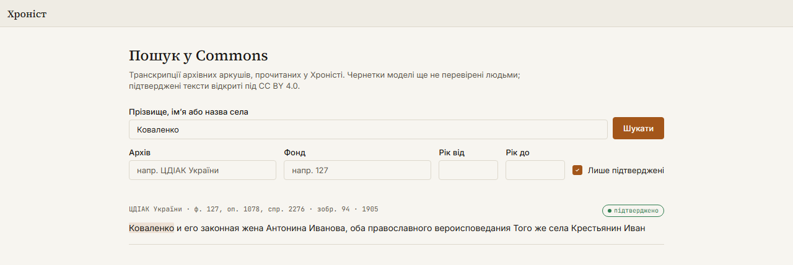

# Посібник користувача

Хроніст допомагає читати оцифровані архівні документи: рукопис стає текстом, терміни й дати отримують пояснення з джерелами, а перевірені людьми транскрипції відкриті для всіх під CC BY 4.0.

Посібник для дослідників, генеалогів і всіх, хто працює з архівними сканами. Розробникам — [README](../README.md) і [CONTRIBUTING.md](../CONTRIBUTING.md).

## Зміст

1. [Що потрібно](#що-потрібно)
2. [Встановлення розширення](#встановлення-розширення)
3. [Перший запуск і вхід](#перший-запуск-і-вхід)
4. [Прочитати фрагмент](#прочитати-фрагмент)
5. [Що показує результат](#що-показує-результат)
6. [Пояснення імен, місць, дат і термінів](#пояснення-імен-місць-дат-і-термінів)
7. [Спитати](#спитати)
8. [Виправити рядок](#виправити-рядок)
9. [Підтвердити транскрипцію](#підтвердити-транскрипцію)
10. [Цитата](#цитата)
11. [Уже прочитане на аркуші](#уже-прочитане-на-аркуші)
12. [Пошук у Commons](#пошук-у-commons)
13. [Хроніст в AI-асистенті (MCP)](#хроніст-в-ai-асистенті-mcp)
14. [Що відбувається з даними](#що-відбувається-з-даними)
15. [Обмеження](#обмеження)
16. [Якщо щось пішло не так](#якщо-щось-пішло-не-так)

## Що потрібно

- **Google Chrome 116 або новіший** на комп'ютері.
- **Скан на підтримуваному порталі.** Зараз це е-ресурс ЦДІАК України [archium.cdiak.archives.gov.ua](https://archium.cdiak.archives.gov.ua), сторінка переглядача справи (адреса з `/file-viewer/`). Інших порталів ще немає.

Щоб спробувати, відкрийте, наприклад, [метричну книгу 1896 року](https://archium.cdiak.archives.gov.ua/file-viewer/131976) (ф. 127, оп. 1078, спр. 177: парафії Братської й Петропавлівської Борщагівки, Боярки, Будаївки).

Для пошуку в Commons нічого встановлювати не треба: він працює в будь-якому браузері на [app.khronist.org](https://app.khronist.org).

## Встановлення розширення

У Chrome Web Store Хроніста ще немає, тож розширення встановлюється вручну.

### З архіву

Якщо команда дала вам архів розширення (`.zip`):

1. Розпакуйте архів в окрему теку, яку не видалятимете: Chrome завантажує розширення саме з неї.
2. Відкрийте `chrome://extensions`.
3. Увімкніть режим розробника перемикачем праворуч угорі (англійською — **Developer mode**).
4. Натисніть кнопку завантаження розпакованого розширення (англійською — **Load unpacked**) і виберіть розпаковану теку.

### Із вихідного коду

Потрібні Node.js 24 і pnpm 12.16.1 (`npm install -g pnpm@12.16.1`).

```sh
git clone https://github.com/code-by-accident/Khronist-real-platform.git
cd Khronist-real-platform
pnpm install
pnpm --filter @khronist/extension build
```

Далі — кроки 2–4 з попереднього розділу, тека `apps/extension/.output/chrome-mv3`. Така збірка працює з робочим сервером `api.khronist.org`.

### Закріпіть іконку

Натисніть значок пазла праворуч від адресного рядка й закріпіть **Хроніст**. Клік по іконці відкриває бічну панель.

Гаряча клавіша — **Alt + Shift + X**. Якщо її вже зайняло інше розширення, Chrome її не призначить; тоді задайте свою на `chrome://extensions/shortcuts`.

## Перший запуск і вхід

Під час першого відкриття панель коротко показує, як працює Хроніст, і пропонує два шляхи:

- **«Почати без входу».** Без входу можна читати фрагменти, дивитися пояснення, питати й робити цитати.
- **«Увійти».** Вхід потрібен лише для правок і підтвердження.

### Вхід кодом із листа

Пароля немає.

1. Введіть електронну пошту й натисніть **«Надіслати код»**.
2. Введіть 6 цифр із листа. Код діє 5 хвилин.
3. Якщо лист не прийшов, через хвилину з'явиться **«Надіслати ще раз»**. Помилилися в адресі — **«Інша адреса»**.

Вхід тримається, доки відкрито браузер; після перезапуску Chrome увійдіть знову.

### Профіль і підпис

Іконка користувача в шапці панелі відкриває профіль. Тут можна:

- задати **«Підпис підтверджень»** (до 80 символів). Його видно всім поруч із вашими правками й підтвердженнями;
- побачити й змінити гарячу клавішу;
- **«Вийти»**.

## Прочитати фрагмент

1. Відкрийте скан у переглядачі ARCHIUM і відкрийте панель Хроніста. У шапці з'явиться шифр: архів, фонд, опис, справа й номер зображення.
2. Натисніть **«Виділити фрагмент»** (або ще раз Alt + Shift + X).
3. Обведіть мишею **цілий запис** на аркуші. Esc скасовує виділення.
4. Панель показує фрагмент і кроки «Читання рукопису» та «Нормалізація та сутності». Коли модель дочитає фрагмент, рядки з'являться в панелі.

> [!TIP]
> Виділяйте цілий запис, а не окреме слово: модель читає краще, коли бачить контекст. Якщо виділення обрізає текст, панель про це попередить.

Читання працює й тоді, коли шифр не розпізнано, але без шифру не буде цитати й підтвердження.

Поки ви працюєте з результатом, можна гортати справу: коли ви відкриєте інше зображення й усі правки збережено, панель повернеться до виділення на новому аркуші.

## Що показує результат

- **Транскрипція.** Рядки фрагмента пронумеровано по порядку (01, 02…) і записано в старій орфографії, як в оригіналі.
- **Непевні слова** підкреслено пунктиром. Наведіть курсор, щоб побачити «Модель не впевнена в цьому слові». Невпевненість моделі не ховається: саме ці слова варто звірити зі сканом.
- **Попередження.** Якщо виділення обрізає текст, папір пошкоджено чи чорнило бліде, панель скаже про це над рядками.
- **«Українською».** Для запису російською під рядками є машинний переклад з тими самими номерами рядків: рядок 02 перекладу відповідає рядку 02 оригіналу. Рядки, в оригіналі яких є непевні слова, підкреслено цілком. Це переклад, тобто інтерпретація, тож звіряйте його з оригіналом.
- **«Сучасною орфографією».** Якщо перекладу немає, панель показує текст у сучасній орфографії й список розкритих скорочень, коли сервер їх знайшов.
- **«Сутності».** Імена, місця, дати й терміни з тексту, у порядку появи.
- **Бейдж стану:** «чернетка моделі» (ще ніхто не перевірив) або «підтверджено · ім'я · дата».

## Пояснення імен, місць, дат і термінів

Клікніть чип сутності, і знизу відкриється пояснення.

- Хроніст відповідає **лише за довідковим корпусом** і під відповіддю показує джерело та його ліцензію.
- Для дати є переведення зі старого стилю (юліанський календар) у новий і день тижня.
- Якщо джерела відповідають лише частково, з'явиться позначка «звірте зі статтею».
- Якщо в корпусі нічого немає, Хроніст так і каже: «У довідковому корпусі немає пояснення». Вигаданих відповідей не буде.

Закрити пояснення можна кнопкою «Закрити», клавішею Esc або кліком поза ним.

## Спитати

Вкладка **«Спитати»** — чат про терміни, дати, місця чи прочитаний фрагмент.

- Перемикач **«Відповідати з урахуванням прочитаного фрагмента»** додає до запитання текст прочитаного фрагмента, тож можна питати саме про цей запис.
- Під відповіддю — її джерела: назва статті корпусу з ліцензією або «з транскрипції фрагмента».
- Без джерела Хроніст не вигадує, а так і каже: «У довідковому корпусі немає відповіді на це запитання» (з увімкненим перемикачем — «У записі й довідковому корпусі…»).
- Над полем запитання бувають кнопки з наступними запитаннями: клік одразу надсилає запитання.

Новий фрагмент починає нову розмову.

## Виправити рядок

Потрібен вхід.

1. Клікніть рядок у результаті. Над транскрипцією з'явиться «ви редагуєте».
2. Виправте текст. Панель **«Старі літери»** вставляє ѣ, і, ъ, ѳ, ѵ, ѡ, ѧ, ѹ туди, де стоїть курсор.
3. **Enter** — наступний рядок, **Esc** — скасувати правку рядка.

Правки зберігаються, коли ви закінчуєте серію: вийшли з рядків, натиснули Esc чи Enter на останньому рядку. Уся серія стає однією новою версією. Виправлені рядки позначено точкою. Якщо ви редагували без входу, панель попросить увійти й збереже правки після входу. Незбережені правки живуть лише у відкритій панелі: якщо закрити її раніше, вони пропадуть.

### Якщо текст змінив хтось інший

- Якщо інша людина змінила **інші** рядки, ваші правки просто ляжуть поверх її версії.
- Якщо **ті самі** рядки, з'явиться «спірне» й кнопка **«Порівняти»**: ви побачите обидві версії й виберете **«Залишити моє»** чи **«Прийняти чуже»**.

У вже підтвердженого фрагмента є смуга «Цей фрагмент підтвердив(ла) …» з дією **«Запропонувати виправлення»**.

## Підтвердити транскрипцію

Підтвердження робить текст частиною відкритого шару Commons. Кнопку **«Підтвердити»** бачать лише перевірені учасники (команда проєкту й історик-консультант), і лише тоді, коли:

- у фрагмента є шифр;
- текст ще не підтверджено;
- жоден рядок не відкрито й усі правки збережено.

Перед підтвердженням панель питає: «Підтвердити N рядків як прочитані вами?» і нагадує, що текст стане публічним під CC BY 4.0 з вашим підписом. Позначка **«Більше не питати»** прибирає це питання надалі.

Після підтвердження бейдж стає «підтверджено · ім'я · сьогодні», а головна кнопка — **«Наступний фрагмент»**.

## Цитата

Кнопка **«Цитата»** доступна всім, і без входу теж, якщо у фрагмента є шифр і немає незбережених правок.

- Формати: **ДСТУ** (ДСТУ 8302:2015), **Markdown** і **Текст**.
- Перемикач **«З транскрипцією»** додає прочитані рядки й примітку про стан версії: чернетка чи ким і коли підтверджено. У непідтвердженій версії непевні слова в цитаті позначено `[?]`.
- **«Скопіювати»** кладе текст у буфер обміну.

Приклад у форматі ДСТУ: `ЦДІАК України. Ф. 127. Оп. 1078. Спр. 177. Зобр. 5.` Якщо в аркуша є посилання на портал, далі йде `URL: … (дата звернення: …)`.

Цитата береться з останньої підтвердженої версії фрагмента, а якщо підтвердженої немає — з останньої. Тому вона може відрізнятися від новішої чернетки в панелі.

## Уже прочитане на аркуші

Коли ви відкриваєте аркуш, панель показує бейдж «ще не прочитано» або «прочитано · 2 фрагменти · підтверджено 1» і список **«Уже прочитано на цьому аркуші»**. Клік по фрагменту відкриває його одразу, без нового читання.

Нове виділення того самого запису майже ніколи не збігається з попереднім до пікселя, тож читається заново. Уже прочитане відкривайте з цього списку.

## Пошук у Commons

[app.khronist.org](https://app.khronist.org) — публічний пошук серед прочитаних у Хроністі аркушів. Вхід не потрібен.



- Шукайте за **прізвищем, ім'ям або назвою села**. Пошук враховує давні й сучасні написання з довідкового словника.
- Слова коротші за три літери, числа, римські цифри й службові слова пошук не враховує.
- Фільтри: **архів**, **фонд**, **рік від / рік до**.
- **«Лише підтверджені»** увімкнено типово. Зніміть позначку або, якщо збігів немає, натисніть **«Шукати й у чернетках»**, щоб побачити й ще не перевірені людьми тексти моделі.
- Адресу сторінки з результатами можна надіслати колезі: посилання одразу відкриває той самий пошук.
- **«Відкрити скан на порталі»** є в тих результатах, для яких відомо посилання на скан.

## Хроніст в AI-асистенті (MCP)

Читання, пояснення й пошук доступні також як MCP-сервер для AI-асистентів, які підтримують MCP, наприклад Claude Desktop:

- `transcribe` — прочитати PNG-фрагмент скану;
- `explain` — пояснити термін, топонім, дату чи сутність за корпусом;
- `search_sources` — пошук у Commons.

Сервер запускається з клону репозиторію. Без ключа API діють ліміти гостя. Налаштування — в [apps/mcp/README.md](../apps/mcp/README.md).

## Що відбувається з даними

- **Скани не зберігаються.** Панель надсилає лише виділений фрагмент; сервер зберігає його хеш, шифр аркуша й прочитаний текст, а не зображення.
- **Фрагмент читає стороння мультимодальна модель.** Виділене зображення, а для пояснень і чату — текст запитання й фрагмента надсилаються постачальнику моделі.
- **Прочитане стає чернеткою в Commons.** Текст, який прочитала модель, видно в пошуку, якщо зняти «Лише підтверджені», з позначкою «чернетка моделі». Фрагменти без шифру в пошук не потрапляють.
- **Підтверджене публічне під CC BY 4.0.** У панелі й у цитаті поруч із текстом стоїть ім'я або підпис того, хто підтвердив.
- **Акаунт — це пошта й підпис.** Пошта потрібна для входу, підпис видно всім поруч із вашими правками й підтвердженнями. Для сесії входу сервер записує IP-адресу й браузер, а правки й підтвердження прив'язані до акаунта.
- **Пояснення й чат** працюють лише з довідковим корпусом і показують джерела.

## Обмеження

Щоб сервер лишався доступним для всіх, запити з однієї IP-адреси обмежено:

| Що | Ліміт |
| --- | --- |
| Читання фрагментів | 10 запитів на хвилину (разом із повторними з кешу), 300 нових читань на добу, до 3 одночасно |
| Пояснення | 10 на хвилину, 100 на добу |
| Чат | 10 на хвилину, 50 на добу |
| Пошук у Commons | 60 на хвилину |

Понад ліміт панель чи сайт попросять зачекати. Крім того, у сервера є спільний добовий бюджет викликів моделі (доба — за UTC). Коли витрачено три чверті, тимчасово недоступні пояснення й чат; коли весь — нові читання. Уже прочитане відкривається й далі.

## Якщо щось пішло не так

| Що бачите | Що зробити |
| --- | --- |
| «Відкрийте скан на підтримуваному порталі», хоча справу відкрито | Перезавантажте вкладку. Так буває після встановлення чи оновлення розширення |
| «Виділення замале: обведіть увесь запис» | Обведіть більшу ділянку: сторони мають бути не менші за 24 пікселі |
| «Скан ще завантажується» | Зачекайте, доки скан з'явиться повністю, і виділіть знову |
| «Виділення не потрапило на скан» | Обводьте сам аркуш, а не поля переглядача навколо |
| «Фрагмент завеликий або пошкоджений» | Виділіть меншу ділянку |
| «Немає зв’язку із сервером» | Перевірте інтернет і натисніть «Спробувати ще раз» |
| «Сервер не відповів вчасно» | Натисніть «Спробувати ще раз» |
| Багато непевних слів | Виділіть один цілий запис, без сусідніх; звірте підкреслені слова зі сканом і виправте їх |
| Гаряча клавіша не працює | Задайте її на `chrome://extensions/shortcuts`. Якщо розширення встановили до появи гарячої клавіші й потім оновили кнопкою «Оновити», Chrome її не призначає |
| Немає кнопки «Підтвердити» | Підтверджувати можуть лише перевірені учасники. Кнопки також немає, якщо фрагмент без шифру чи вже підтверджений, відкрито рядок або є незбережена правка |
| Немає кнопки «Цитата» | Шифр не розпізнано або є відкритий рядок чи незбережена правка |
| Код входу не приходить | Перевірте адресу й папку «Спам», через хвилину натисніть «Надіслати ще раз» |

Знайшли помилку чи маєте ідею? Напишіть нам через [Issues](https://github.com/code-by-accident/Khronist-real-platform/issues) репозиторію.
